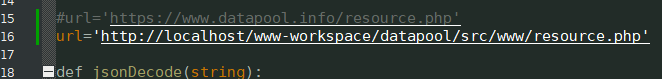
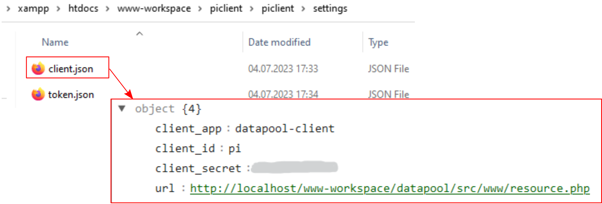
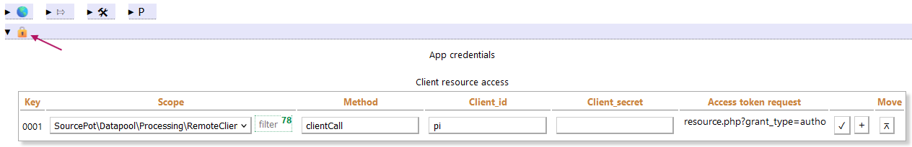
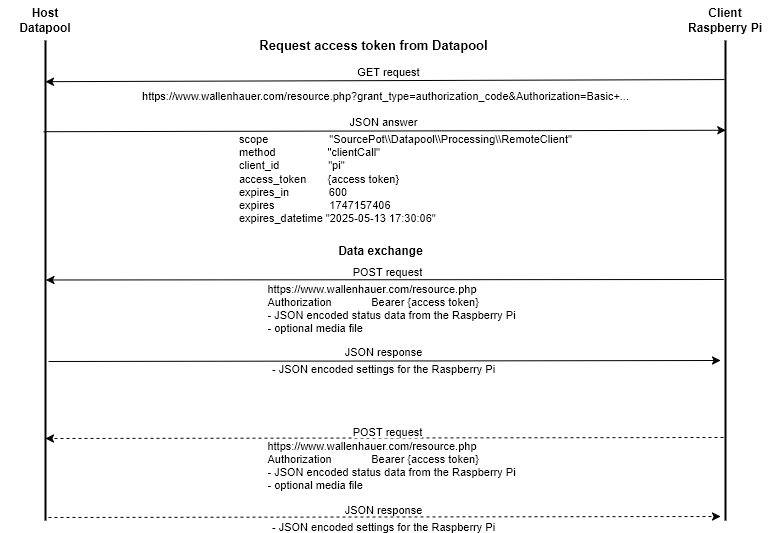
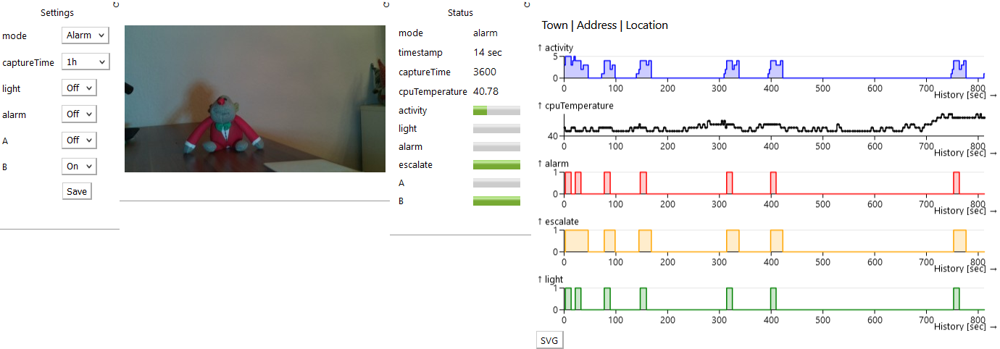

# Raspberry Pi Client
The Python code in this repository runs on a Raspberry Pi and enables the Pi to connect to the Datapool web application.
It connects through the Datapool processor `SourcePot\Datapool\Processing\RemoteClient` and can be used with any data app.

A typical use case is a motion-triggered camera.

Examples include the following photograph of Mr. Fox and an image from a repair and cleaning session:


## How does it work?

The `request` method of `SourcePot\Datapool\Foundation\ClientAccess` receives requests from multiple Raspberry Pis. The clients send these requests by regularly calling `../resource.php`. Each request can then be processed only when the client is registered with a Datapool user account.

If the registered scope is `SourcePot\Datapool\Processing\RemoteClient` and the method is set to `clientCall`, the `RemoteClient` class receives requests containing status information, sensor data, and/or files such as images and videos. The web application returns the corresponding settings for each Raspberry Pi in response.

## First steps on the side of the Raspberry Pi
To set up the Raspberry Pi client, create a folder on the Raspberry Pi and copy the following three Python files into it:

1. \_\_init\_\_.py
2. datapoolclient.py
3. sentinel.py

In `datapoolclient.py`, set the URL to the address of **your** Datapool web application:

Alternatively, specify the web application address in the `client.json` file described below.

When `sentinel.py` runs for the first time, `datapoolclient.py` creates a set of subdirectories. Update the `client.json` file in the newly created `settings` subdirectory.

> [!IMPORTANT]  
> The `settings/client.json` file contains access details such as the Datapool web application URL, `client_id`, and `client_secret`.

These details must match the client registration within the Datapool web application.



The Pi location is loaded from `settings/location.json` at startup. If the file does not exist, `sentinel.py` creates it with placeholder values. Use the following format:

```json
{
  "town": "Town",
  "address": "House and street",
  "location": "Building",
  "geo": {
    "lat": "52.5200",
    "lon": "13.4050"
  }
}
```

## Remote client registration within Datapool
Register the new client with a Datapool user account. To do this, open **Admin** &rarr; **Account** and expand **App credentials** (lock symbol).

The registered client has the same privileges as the associated user, but only within the selected scope. For the Raspberry Pi client, set the scope to `SourcePot\Datapool\Processing\RemoteClient` and the method to `clientCall`. The `clientCall` method of `SourcePot\Datapool\Processing\RemoteClient` handles requests from the client.

The following screenshot shows the registration of the client in row 0001:



Multiple Raspberry Pis can use the same `client_id` as clients. They are distinguished by their locations, which are configured in `sentinel.py` with `entry={'Group':'Town','Folder':'Address','Name':'Location'}`. Replace `Town`, `Address`, and `Location` with the appropriate values.

When a Raspberry Pi connects to the Datapool host for the first time, Datapool creates a database entry in the `remoteclient` table based on `Town`, `Address`, and `Location`. The entry's `EntryId` is `{baseEntryId}_definition` and contains the HTML widget templates for status and settings. These templates are supplied by the Raspberry Pi: the Pi's Python script defines the user interface in the Datapool web application. Settings that control the Raspberry Pi are stored in the same table in an entry whose `EntryId` is `"..._setting"`. The most recent data supplied by the Raspberry Pi is stored in another entry with `EntryId={baseEntryId}_lastentry`.



Initially, the client requests a new access token. Once it has the token, the client can send status data such as measurements and sensor readings, as well as optional media files such as images or videos in a POST request. The Datapool host responds with updated settings for the client.

## Example view of the Datapool web application
The `RemoteClient` processor provides a user interface defined by the remote client's Python code. In `sentinel.py`, the `Content||Settings||...` key of the `entry` dictionary defines control elements, while `Content||Status||...` defines status elements. This allows each remote client to provide different features and specify its own controls, such as buttons, drop-down menus, and sliders.



# Automatic startup of the Pi Client on a Raspberry Pi
This example uses Debian Trixie on the Raspberry Pi and assumes that the Pi client Python files are in `/home/carsten/Pi/`.

First, create a `systemd` service that executes `sentinel.py` every time the system boots. The script then runs in an infinite loop.

```
sudo -i
cd /etc/systemd/system/
nano pi.service
```
The last command opens `pi.service` in the editor. Add the following configuration:

```
[Unit]
Description=This service starts the RaspberryPi Sentinel
After=network.target

[Service]
ExecStart=/usr/bin/python3 /home/carsten/Pi/sentinel.py
WorkingDirectory=/home/carsten/Pi/
Restart=always
User=carsten

[Install]
WantedBy=multi-user.target
```
Use the following commands to set the file permissions:

```
sudo chmod 744 /home/carsten/Pi/sentinel.py
sudo chmod 664 /etc/systemd/system/pi.service
```
Finally, reload `systemd` and enable the new `pi.service`:

```
sudo systemctl daemon-reload
sudo systemctl enable pi.service
```
After the next system startup, `pi.service` starts the `sentinel.py` Python script. To check whether the service started correctly or encountered errors, run:

```
sudo systemctl status pi.service
```